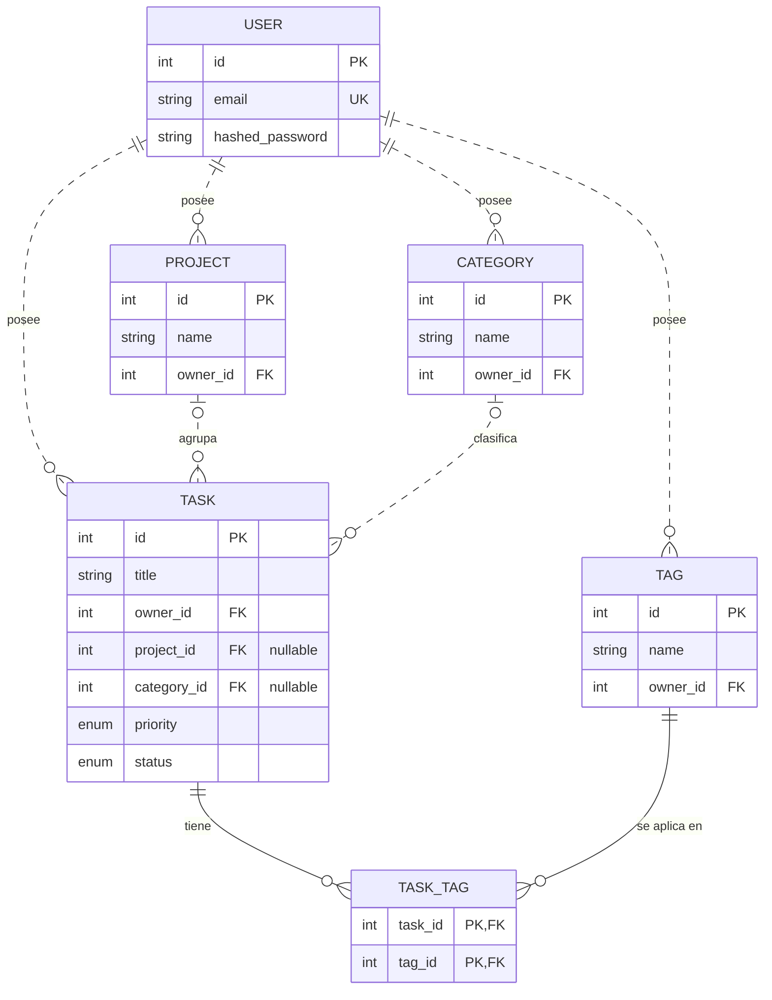

# Modelo de datos — Núcleo (Semana 1)

Entidades núcleo: `User`, `Project`, `Category`, `Tag`, `Task` + tabla puente `task_tag`.

## ERD

## Notas de diseño

task_tag es una tabla de asociación dado que es una tabla auxiliar para representar la relación muchos-a-muchos entre las tareas y etiquetas (una tarea puede tener varias etiquetas, y una etiqueta puede vincularse a varias tareas). Por eso, es un `Table` simple y no una clase que hereda de `Base` porque no tiene atributos propios aparte de las dos claves foráneas, y no hay ningún objeto que modelar.

Task tiene obligación `owner_id`, pero `project_id` y `category_id` son opcionales, ya que se desea que la tarea deba pertenecer al usuario que la creó, pero debe tener la opción de agregarla a un proyecto o categoría, o dejarla independiente.

## Pendiente

- `PomodoroPreference`, `Session`, `SessionTask`, `Interval`
